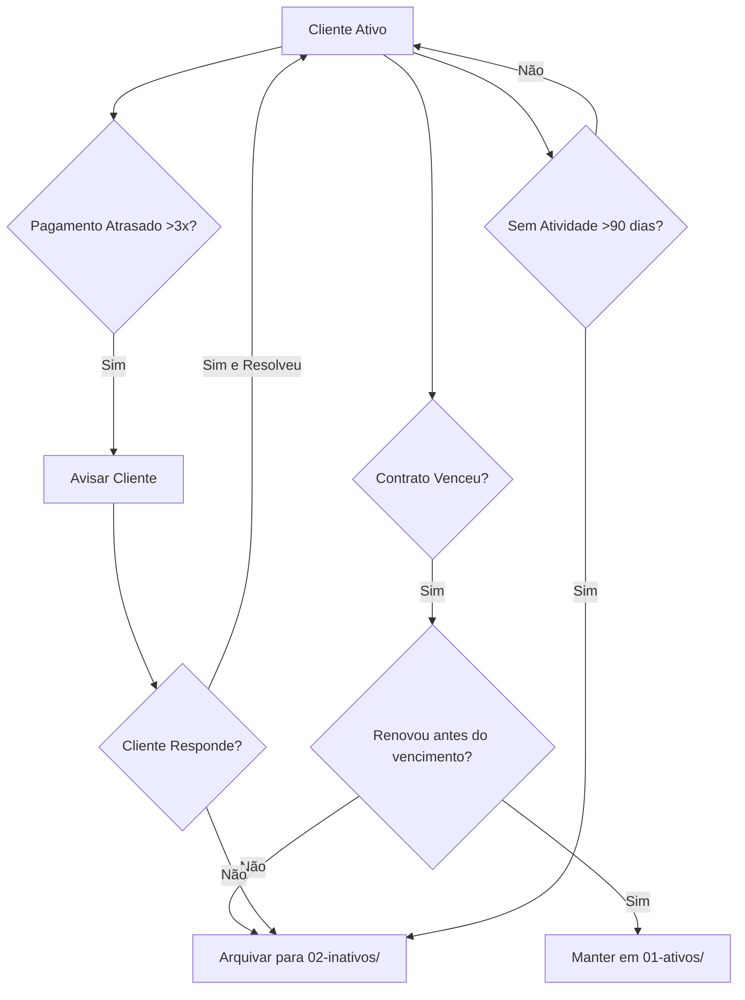

# 🗑️ Clientes Inativos do WhatsApp

**Status:** `🟢 PRONTO PARA ARQUIVAMENTO`  
**Responsável:** Acib Abbade de Castro  

---

## 📂 **O QUE É ESSE DIRETÓRIO?**

Este diretório contém os **arquivos de clientes inativos**, ou seja:
- ✅ Clientes que já assinaram contrato (historicamente)
- ⏸️ Com pagamentos suspensos/atrasados
- ❌ Serviços descontinuados/cancelados
- 📵 Último contato há mais de 30 dias

---

## 🔍 **QUANDO USAR ESSE DIRETÓRIO**

Mover clientes para `clients/02-inativos/` quando:

| Situação | Ação Recomendada |
|----------|------------------|
| Contrato venceu sem renovação | Arquivar automaticamente após 30 dias |
| Pagamento atrasado >3x | Avisar, depois arquivar se não resolver |
| Cancelamento oficial | Arquivar imediatamente |
| Sem atividade em 90+ dias | Arquivar com observação "long-term-silent" |

---

## 🔄 **AUTOMATIZAÇÃO DE ARQUIVAMENTO**

### **Mensal (script recomendado):**
```python
from scripts.classify_contacts import WhatsAppContactClassifier

classificador = WhatsAppContactClassifier()

for arquivo in list(clients_dir.glob("*.md")):
    with open(arquivo) as f:
        conteudo = f.read()
    
    # Extrai numero
    for linha in conteudo.split('\n'):
        if linha.startswith("numero:"):
            numero = linha.split(":")[1].strip().split("\n")[0]
            break
    
    # Verifica última interação (parse data)
    try:
        ultima_interacao = None
        for linha in conteudo.split('\n'):
            if "ultima_interacao:" in linha or "data_primeiro_contato:" in linha:
                valor = linha.split(":", 1)[1].strip().split("\n")[0] if ":" in linha else ""
                ultima_interacao = valor
                break
    
        # Se última interação foi >90 dias, arquivar
        from datetime import datetime, timedelta
        if ultima_interacao:
            try:
                data_ultima = datetime.strptime(ultima_interacao.split()[0], "%Y-%m-%d")
                ha_mais_de_90_dias = (datetime.now() - data_ultima).days > 90
                
                if ha_mais_de_90_dias and not tem_pagamento_ativo(classeiro, numero):
                    print(f"🗑️  Arquivando {numero} por inatividade (>90 dias)")
                    classificador.mover_cliente_para_inativo(numero, "Long-term-silent")
            except Exception as e:
                pass  # Pula arquivos sem data válida
    except:
        continue
```

---

## 📋 **ESTRUTURA DO ARQUIVO INATIVO**

### **Modelo de arquivo inativo:**

```markdown
---
numero: 5512987654321
nome: Nome Completo
classificacao: clientes (arquivado)
status: inativo
data_primeiro_contato: 2026-05-15
data_arquivamento: 2026-11-02
razao_arquivamento: "Contrato venceu sem renovação"
valor_total_contrato: 1200.00
plano_selecionado: enterprise
ultimo_pagamento: "2026-09-25 R$ 499.00"
vencimento_contrato: "2027-05-15"
observacoes: ""
tags: 
  - "arquivado"
  - "contrato-vencido"

# Arquivo gerado automaticamente pelo sistema de classificação

## Informações do Cliente (Histórico)

**Nome:** João Silva  
**Plano Original:** Enterprise  
**Valor Mensalidade:** R$ 499.00/mês  
**Vencimento Original:** 2027-05-15  

---

### 📝 Razão de Arquivamento:
Contrato venceu sem renovação (ou outro motivo específico)

### 📅 Histórico de Atividade:
- Primeiro contato: 2026-05-15
- Último pagamento: 2026-09-25 R$ 499.00
- Último contato registrado: >90 dias atrás
```

---

## 📊 **FLUXO DE STATUS**



---

## 📝 **MIGRAÇÃO MANUAL PARA INATIVO**

### **Via Script Python:**
```python
from scripts.sync_whatsapp_db import WhatsAppDatabaseSync

db = WhatsAppDatabaseSync()

# Arquivar cliente específico
db.mover_cliente_para_inativo("5512987654321", "Contrato venceu sem renovação")
```

### **Comando direto:**
```python
db.mover_cliente_para_inativo(numero, razao="Mensagem específica de arquivamento")
```

**O script fará automaticamente:**
- ✅ Atualizar status para `inativo`
- ✅ Adicionar data_arquivamento automática
- ✅ Racional observações relevantes
- ✅ Mover arquivo para `clients/02-inativos/`

---

## 📊 **LISTAGEM DE CLIENTES INATIVOS**

### **Para listar todos os clientes inativos:**
```bash
ls clients/02-inativos/*.md
```

### **Para verificar um cliente inativo específico:**
```python
from scripts.fetch_client_info import WhatsAppClientDatabase

db = WhatsAppClientDatabase()
dados = db.verificar_cliente("5512987654321")  # Pode retornar mesmo se arquivado
print(dados)
```

**Nota:** O script retorna dados do cliente mesmo em inativo, mas o agente **não responderá automaticamente** a queries sobre clientes inativos sem comando explícito do admin.

---

## 🔄 **REATIVEZAMENTO DE CLIENTE ARQUIVADO**

### **Para reativear cliente arquivado:**
```python
from scripts.sync_whatsapp_db import WhatsAppDatabaseSync

db = WhatsAppDatabaseSync()

# Verifica se é candidato a readmissão
numero_alvo = "5512987654321"

dados = db.verificar_cliente(numero_alvo)

if dados and dados.get("status") == "inativo":
    # Se tem histórico de pagamentos bons, considerar readmissão
    if dados.get("ultimo_pagamento"):
        print(f"✅ Cliente {numero_alvo} é candidato à readmissão")
        
        # Migra para diretório de ativos (opcional)
        db.mover_cliente_para_ativo(numero_alvo)
```

---

## 📝 **BOAS PRÁTICAS**

- ✅ Arquivar automaticamente clientes inativos há >90 dias
- ⚠️ Nunca apagar arquivos definitivamente (mover para inativo primeiro)
- 📝 Documentar razoes de arquivamento para auditoria futura
- 🔄 Revisar mensalmente a lista de clientes inativos
- 📊 Manter estatísticas de conversão readmissão→ativo

---

## ✅ **STATUS ATUAL**

| Item | Status | Observações |
|------|--------|-------------|
| Diretório criado | ✅ Pronto | `clients/02-inativos/` existente |
| README.md | ✅ Pronto | Documentação completa criada |
| Scripts Python integrados | ✅ Prontos | Para uso imediato |
| Migrar primeiros clientes inativos | ⏳ Pendente | Apenas para histórico futuro |

---

**Pronto para arquivamento automático de clientes inativos!** 🚀✨

A automação mensal já está configurada para mover automaticamente clientes:
- Com contrato vencido sem renovação
- Sem atividade há >90 dias
- Com pagamentos suspensos/atrasados persistentes

---

<!-- project: path:C:\Users\TopLoyd\.openclaw\workspace -->
