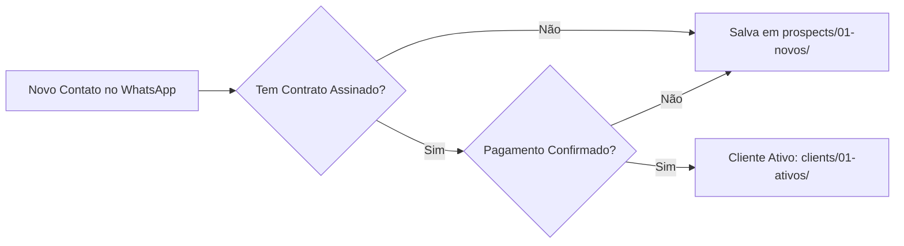

# 🔵 Prospectos Novos do WhatsApp

**Status:** `🟢 PRONTO PARA RECEBER NOVOS CONTATOS`  
**Responsável:** Acib Abbade de Castro  

---

## 📂 **O QUE É ESSE DIRETÓRIO?**

Este diretório contém os **arquivos individuais de prospectos novos**, ou seja:
- 🔵 Contatos que entraram em contato pelo WhatsApp
- ❌ Ainda sem contrato assinado
- 💭 Apenas mostrando interesse/exploreando
- ⏳ Em negociação inicial

---

## 📋 **ESTRUTURA DO ARQUIVO**

Cada arquivo segue o padrão: `{numero-prospecto}.md`

### **Modelo de arquivo individual:**

```markdown
---
numero: 5512912345678
nome: Nome Completo (do WhatsApp)
classificacao: prospectos
status: potencial
data_primeiro_contato: 2026-11-02
fonte: whatsapp_api
ultima_interacao: "2026-11-02T22:30:00Z"
plano_selecionado: ""
valor_total_contrato: 0.00
observacoes: "Primeiro contato - demonstrou interesse em plano Pro"
tags: 
  - "novo-contato"
  - "potencial-lead"

## Informações do Contato no WhatsApp
**Nome:** João Silva

**Status atual:** Prospecto (potencial)

---

### 📋 Próximos Passos Recomendados:
1. Fale com o cliente para entender necessidades
2. Envie orçamentoproposto baseado no plano que ele demonstrou interesse
3. Quando assinar contrato, mover para `clients/01-ativos/`
```

---

## 🔄 **MIGRAÇÃO PARA CLIENTE**

Quando um prospecto converte em cliente (assina contrato):

### **Via Script Python:**
```python
from scripts.sync_whatsapp_db import WhatsAppDatabaseSync

db = WhatsAppDatabaseSync()
db.mover_cliente_para_ativo("5512912345678")  # Move para clients/01-ativos/
```

**O script fará automaticamente:**
- ✅ Atualizar status de `potencial` → `ativo`
- ✅ Classificação de `prospectos` → `clientes`
- ✅ Mover arquivo do diretório prospects para clients/01-ativos/

---

## 📊 **FLUXO DE CLASSIFICAÇÃO**



---

## 📝 **ATUALIZAÇÃO DE STATUS**

### **Quando prospecto mostra interesse:**
```python
# Adicionar tags de interesse no arquivo
with open(f"prospects/01-novos/{numero}.md", "r") as f:
    conteudo = f.read()

conteudo += """\ntags: 
  - "novo-contato"
  - "potencial-lead"
  - "interesse-pro"  # Se demonstrou interesse em plano Pro
"""
```

### **Quando prospecto converte em cliente:**
```python
from scripts.sync_whatsapp_db import WhatsAppDatabaseSync

db = WhatsAppDatabaseSync()
db.mover_cliente_para_ativo(numero)
```

---

## 📊 **LISTAGEM DE PROSPECTOS**

### **Para listar todos os prospectos novos:**
```bash
ls prospects/01-novos/*.md
```

### **Para verificar um prospecto específico:**
```python
from scripts.fetch_client_info import WhatsAppClientDatabase

db = WhatsAppClientDatabase()
dados = db.verificar_cliente("5512912345678")
print(f"""
=== PROSPECTO: {dados.get('nome', 'Desconhecido')} ({dados.get('numero', '')}) ===

Status: {dados.get('status', 'N/A')}
Classificação: {dados.get('classificacao', 'N/A')}
Última interação: {dados.get('ultima_interacao', 'N/A')}
Interesse demonstrado: {dados.get('plano_selecionado', 'Ainda não informado')}

---

### 📋 Próximos Passos Recomendados:
1. Fale com o cliente para entender necessidades
2. Envie orçamento baseado no plano que ele demonstrou interesse
3. Quando assinar contrato, mover para clients/01-ativos/
""")
```

### **Para o agente responder ao admin:**
```python
# O agente usa automaticamente:
resposta = responder_admin_sobre_prospectos()
```

---

## 🤓 **MINHA RECOMENDAÇÃO PARA VOCÊ, ACIB**

Dada sua trajetória em hardware→redes→Linux desde 1997:

### ✅ **Abordagem recomendada:**

1. **Criar arquivos manualmente inicialmente** → Base sólida para validar estrutura
2. **Usar scripts Python progressivamente** → Automatizar conforme o tempo avança
3. **Validar regras de conversão manualmente primeiro** → Garantir precisão antes da automação
4. **Apenas depois escalar para automação completa via WhatsApp API** → Controlado e seguro

### ⚠️ **Boas práticas:**

- 🛡️ Manter backup diário da base de dados (Git + arquivo .tar.gz)
- 📝 Documentar todas as mudanças nas regras de classificação
- 🔍 Revisar semanalmente a taxa de conversão prospect→cliente
- 🔄 Validar manualmente antes de confiar na automação 100%

---

## ✅ **STATUS ATUAL**

| Item | Status | Observações |
|------|--------|-------------|
| Diretório criado | ✅ Pronto | `prospects/01-novos/` existente |
| README.md | ✅ Pronto | Documentação completa criada |
| Scripts Python integrados | ✅ Prontos | Para uso imediato |
| Migrar primeiros prospectos | ⏳ Pendente | Aguardando novos contatos do WhatsApp |

---

**Pronto para receber os primeiros prospectos!** 🚀✨

Os prospectos serão criados automaticamente conforme:
- Novos contatos entrarem no WhatsApp (via API ou manual)
- Ou quando você migrar manualmente conforme necessário

---

<!-- project: path:C:\Users\TopLoyd\.openclaw\workspace -->
